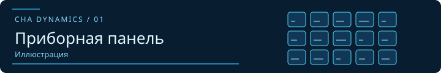
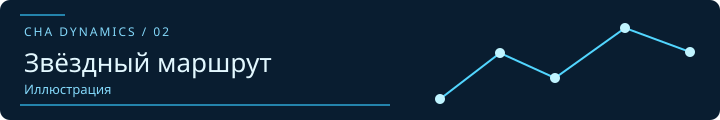

# CHA Dynamics Elite Dangerous

Два проекта RacerCHA для пилотов Elite Dangerous. Один выводит показания корабля на Stream Deck, второй помогает пользоваться Neutron Dancer на русском языке.

## CHA Dynamics MFD для Stream Deck

**Windows · Stream Deck MK.1 · 15 клавиш**

Синий приборный экран для физической панели Stream Deck. Показания на клавишах меняются по данным телеметрии Elite Dangerous.

**[Скачать](https://github.com/RacerCHA/cha-dynamics-elite-mfd-streamdeck/releases)**　·　[Инструкция](https://github.com/RacerCHA/cha-dynamics-elite-mfd-streamdeck#readme)

## Neutron Dancer на русском

**ED Market Connector · Навигация и торговля**

Неофициальный русский перевод плагина Neutron Dancer для ED Market Connector. Плагин помогает с навигацией и торговыми расчётами. Автор оригинала — [dwomble](https://github.com/dwomble/EDMC-NeutronDancer), русский перевод — RacerCHA.

**[Скачать](https://github.com/RacerCHA/cha-dynamics-elite-neutron-dancer-ru/releases)**　·　[Инструкция](https://github.com/RacerCHA/cha-dynamics-elite-neutron-dancer-ru#readme)
